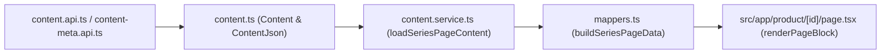

# Agent Notes: Wattsan Website

This repository implements the public storefront and configurator for **Wattsan CNC** equipment.

---

## 1. Project Structure & Architecture

| Layer | Path | Purpose |
| --- | --- | --- |
| **App Router** | `src/app/` | Next.js dynamic & static routes (e.g. `src/app/product/[id]/page.tsx`). |
| **UI Components** | `src/components/` | Modular UI blocks (e.g. `src/components/modules/product-page/`). |
| **API Clients** | `src/api/` | Axios requests to `https://api.wattsancnc.com` using Telerik filter formatting. |
| **Domain Models & Mappers** | `src/classes/` | Domain classes (`Content`, `ContentMeta`, `ContentJson`) that encapsulate mapping and locale resolution. |
| **Services** | `src/services/` | Page-facing orchestration (`content.service.ts`, etc.). |
| **Types** | `src/types/` | TypeScript interfaces for products, specifications, configurator, and page data. |
| **Constants** | `src/constants/` | API URL and the series page content model (`content-sections.ts`). |

---

## 2. Dynamic Content (`Content` & `ContentMeta`) Architecture

Series product pages are built from CMS **blocks**: the admin places block templates in any order (the same template can be used many times) in the dashboard's page builder. The flow is **API &rarr; Class &rarr; Service &rarr; Mapper &rarr; Page**:

### 2.1 Content Model (`src/constants/content-sections.ts`)
All series page rows have `referenceType: 'series_page'` and `referenceId` = series id. The row's `section` says what it is:
- **Page settings** (`SERIES_PAGE_SETTINGS`): `info_cards`, `product_info_extra`, `materials_processing`. One per series; they feed the top of the page (info cards, buy box notes, materials).
- **Block templates** (`BLOCK_TEMPLATES`): named after their layout (e.g. `faq` = "Accordion", `facts_cards` = "Card Carousel"). Ordered by `displayOrder`, hidden when `isActive` is false. Templates with `multiple: true` keep their items as child rows with `referenceType: 'series_page_block'` and `referenceId` = the block's id. Optional `block_title` / `block_description` metas on the block override the component's default heading; titles support `*highlighted*` words (`src/utils/highlight-title.tsx`).
- **System blocks** (`SYSTEM_BLOCKS`): `system_materials`, `system_specifications`, `system_series_comparison`, `system_reviews_questions`, `system_related_products`. Rendered from product data; a series that never placed one gets it appended in default order.

The field definitions themselves live in the dashboard (`views/dynamic-content-list/types.js`).

### 2.2 Domain Models (`src/classes/content.ts` & `src/classes/content-meta.ts`)
- **`Content`**: Represents the section record (`id`, `referenceType`, `referenceId`, `section`, `title`, `displayOrder`, `isActive`).
- **`ContentMeta`**: Represents individual key-value attributes (`keyName`, `type`, `value`, `value_AR`, `filemanager`).
- **`ContentJson`**: Extends `Content`, reducing all `contentMetas` into a clean dictionary `contentMetasJson[keyName]` with automatic locale and filemanager URL resolution. Provides typed conversion methods per template (`toFactsCard()`, `toPowerOfMachine()`, `toHeartOfMachineryTab()`, `toSafetyCabin()`, `toFAQItem()`, `toReviewItem()`, …).

### 2.3 Service Layer (`src/services/content.service.ts`)
- **`readContentAsJsonByFilter(filter, locale)`**: Takes `{ key: value }` equality clauses or a ready Telerik filter string, fetches the content items and missing metas, resolves file manager ids, and returns initialized `ContentJson[]`.
- **`loadSeriesPageContent(seriesId, locale)`**: Loads the series rows and, in one OR query, the items of its multi-item blocks. Returns `{ settings, blocks: [{ block, items }] }` with active blocks in page order.

### 2.4 Page Data (`src/api/product/mappers.ts`)
`buildSeriesPageData(baseData, content)` fills the top-of-page data from the settings (`infoCards`, `materialsProcessing`, `productInfo`) and builds `pageBlocks: ProductPageBlock[]`. Each template has a builder in `BLOCK_DATA_BUILDERS` that turns the block's items (multi-item) or the block row (single) into component props; blocks without content are dropped.

---

## 3. Product Page Integration

### 3.1 Dynamic Product Route (`src/app/product/[id]/page.tsx`)
1. Fetches live product parameters and characteristics via `getProductById(params.id)` and `getFullCharacteristics()`.
2. Fetches the series page via `getProductPageData(product.seriesId)`.
3. Renders the fixed top area (gallery, parameters, buy box, info cards), then `pageBlocks.map(renderPageBlock)`. `renderPageBlock` switches on `section` and renders the matching component, passing the block's heading overrides; system blocks render from product data (specifications, series comparison, related products).

---

## 4. Telerik Query Conventions

The backend `GET /api/Content/Read` and `GET /api/ContentMeta/Read` endpoints use Telerik DataSource filter syntax:
- Single clause: `filter=referenceType~eq~'product_page'`
- Multiple clauses: `filter=referenceType~eq~'product_page'~and~referenceId~eq~'3'`
- OR clauses for IDs: `filter=(contentId~eq~'1'~or~contentId~eq~'2')`
- Paging: `page=1&pageSize=500`
